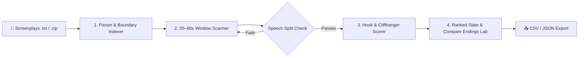

# 🎬 Kuku Promo Finder · Microdrama Studio Suite

> **AI-powered promotional cut extraction, retention scoring, and spoiler verification for short-drama series (Kuku FM, ReelShort, DramaBox).**

[](https://kuku-promo-finder-7ciuu7urvol9veyyasppdg.streamlit.app)
[](https://streamlit.io)
[](https://python.org)
[](LICENSE)

---

## 🌐 Try the Live Prototype

Test the live interactive prototype right in your browser (24/7 Permanent Cloud URL):

👉 **[https://kuku-promo-finder-7ciuu7urvol9veyyasppdg.streamlit.app](https://kuku-promo-finder-7ciuu7urvol9veyyasppdg.streamlit.app)**

*(No login or API key required. Click **"Run Sample Now"** on the first tab to analyze 3 demo microdrama episodes instantly.)*

---

## 💡 What is Kuku Promo Finder?

In high-growth microdramas, audience acquisition lives and dies by **20–60 second vertical promos** on TikTok, Instagram Reels, and YouTube Shorts. 

Human editors typically spend hours scanning 50+ script episodes to find clips that:
1. **Hook the viewer in the first 3 seconds** (immediate action, conflict, or high-stakes dialogue).
2. **Build tension within 20–60 seconds** without resolving it.
3. **End on an unanswered question** that compels a first-time viewer to swipe up and install the app.
4. **Never cut mid-sentence** or leak the answer right after the cut.

**Kuku Promo Finder solves this entirely:** It ingests timestamped screenplay files, indexes dialogue and camera cues, extracts candidate windows, validates speech boundaries with mathematical precision, and ranks the highest-converting launch slate across the entire show.

---

## ⚡ Core Highlights

| Feature | What it does | Why it matters |
|---|---|---|
| **⚡ 3-Second Retention Hook** | Scans the opening 3 seconds of every candidate for conflict signals or sharp dialogue. | Prevents viewers from swiping away in their social media feeds. |
| **⏱ 20–60s Strict Duration** | Calculates exact elapsed play duration at segment boundaries. | Enforces optimal ad and organic reel length without manual calculations. |
| **🛡️ 100% Speech Boundary Safety** | Rejects any edit point that falls mid-speech (`cue.start < point < cue.end`). | Ensures broadcast-ready cuts with zero chopped words. |
| **🔬 Compare Endings (Spoiler Autopsy)** | Displays the chosen cliffhanger out-point side-by-side with the very next line in the script. | Automatically alerts editors if extending the cut by 2 seconds would spoil the mystery. |
| **📱 9:16 Mobile Feed Simulator** | Previews how the cut will appear in a vertical video player with hook overlays and subtitles. | Gives creative directors an instant visual sanity check. |
| **⬇ Production Exports** | Generates `ranked_promos.csv`, `episode_coverage.csv`, and `promo_run.json`. | Direct copy-paste into editing suites (Premiere Pro, DaVinci Resolve, Final Cut). |

---

## 🔬 How the Editorial Engine Works



1. **Parser & Cue Indexer:** Assigns each screenplay cue a sequential ID and centisecond-accurate timestamps (`MM:SS.cc`). Dialogue and non-speech (`CAMERA`, `ACTION`, `SFX`) are differentiated.
2. **Editorial Rules Engine (Offline):** Identifies conflict cues paired with spoken question endings. Calculates elapsed time, score weights, and rejects split speech boundaries.
3. **AI Two-Pass Analysis (Optional):** Can also connect to any OpenAI-compatible LLM to perform deep contextual reasoning on character motives and visual suspense.
4. **Compare Endings Verification:** Inspects the cue immediately following the cut point to confirm that the cliffhanger question is genuinely left open.

---

## 🚀 Quick Start (Local Run)

Run the application locally on your machine in 3 steps:

```bash
# 1. Clone the repository
git clone https://github.com/ABHI-2802/kuku-promo-finder.git
cd kuku-promo-finder

# 2. Install dependencies
pip install -r requirements.txt

# 3. Launch the Streamlit app
streamlit run app.py
```

The app will open automatically at **`http://localhost:8501`**.

---

## ☁️ Deploy to Streamlit Community Cloud (Free 24/7 Hosting)

1. Fork or push this repository to your GitHub account.
2. Go to **[share.streamlit.io](https://share.streamlit.io/)** and sign in.
3. Click **New app**, select `ABHI-2802/kuku-promo-finder`, branch `main`, and main file `app.py`.
4. Click **Deploy!**
5. *(Optional for AI mode)* In the app settings under **Secrets**, add:
   ```toml
   PROMO_API_URL = "https://api.openai.com/v1/chat/completions"
   PROMO_MODEL   = "gpt-4o-mini"
   PROMO_API_KEY = "sk-..."
   ```

*(If no API keys are added, the app operates automatically in high-speed **Offline Mode** with zero external dependencies.)*

---

## 📄 Screenplay File Format

Each `.txt` file must include an episode header and formatted cue blocks:

```text
EPISODE NUMBER: Episode 1

**CAMERA:**
Start: (00:00.00) | End: (00:05.50)
Candlelight fills a crowded hall. The groom stands at the altar.

**VERA:**
Start: (00:05.50) | End: (00:13.00)
"Stop this wedding! That man already has a wife."

**GROOM:**
Start: (00:13.00) | End: (00:22.00)
"She lies! Those documents were destroyed in the fire."

**VERA:**
Start: (00:22.00) | End: (00:31.50)
"Then who delivered a copy to the magistrate's office this morning?"
```

- Spoken cues use character names (e.g., `VERA:`, `GROOM:`).
- Non-speech cues (`CAMERA:`, `ACTION:`, `SOUND FX:`, `MUSIC:`) are parsed and indexed without being treated as dialogue boundaries.

---

## 🧪 Automated Test Suite

A built-in test suite validates the parser, duration math, boundary checking, and export generation:

```bash
python3 test_app.py
```

**Test Coverage:**
- ✅ Screenplay parsing & sequential cue ID assignment
- ✅ centisecond timecode conversion & boundary safety
- ✅ Strict 20–60s duration window enforcement
- ✅ Next-spoken-line spoiler detection logic
- ✅ Validated CSV & JSON serialization
- ✅ In-memory `.zip` upload integrity

---

## 🔒 Privacy & Security

- **Zero Data Leakage:** Screenplay text and generated edit lists are processed in-memory or in local session cache.
- **No Hardcoded Secrets:** Private scripts, `.env` files, and credentials are included in `.gitignore` to prevent repository leaks.

---

## 👤 Author & Credits

Built for microdrama editorial workflows by **Abhishek Biradar**.
- GitHub: [@ABHI-2802](https://github.com/ABHI-2802)
- Repository: [kuku-promo-finder](https://github.com/ABHI-2802/kuku-promo-finder)
